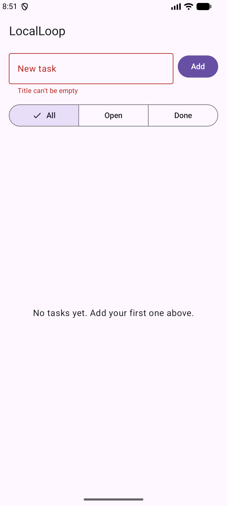
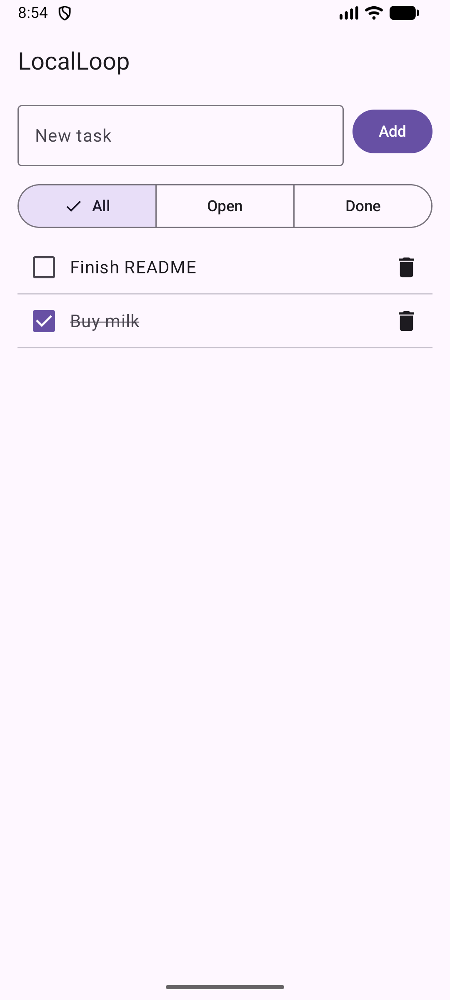
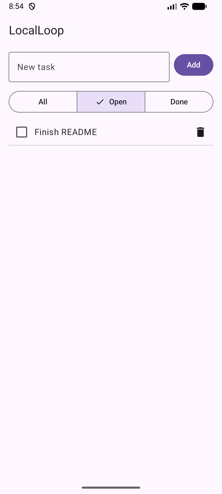
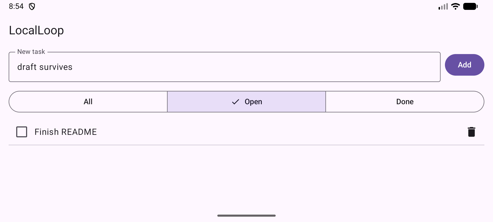

# LocalLoop

A small offline task list for Android. You can add a task, mark it done, filter All / Open / Done and delete it. Tasks are stored locally with Room, so they are still there after the app restarts. There is no login, no network and no backend.

| Empty + validation | Tasks | Filter: Open | Rotated (draft + filter kept) |
|---|---|---|---|
|  |  |  |  |

Screen recording: [`docs/demo.mp4`](docs/demo.mp4) (about 30 s: validation, add, complete, filter, delete, rotate, restart).
All screenshots are in [`docs/screenshots/`](docs/screenshots).

## Build, run, test

Requirements: JDK 17 and an Android SDK with platform 36 installed. Point Gradle at the SDK with `ANDROID_HOME` or a `local.properties` file containing `sdk.dir=...`. Android Studio does this for you.

```bash
# build the debug APK  -> app/build/outputs/apk/debug/app-debug.apk
./gradlew assembleDebug

# install on a running emulator / connected device
./gradlew installDebug

# JVM unit tests (ViewModel, filtering, validation)
./gradlew testDebugUnitTest

# instrumented tests (Room + Compose UI); needs a running emulator or device
./gradlew connectedDebugAndroidTest
```

On Windows use `gradlew.bat` instead of `./gradlew`.

### Tool versions used

| Tool | Version |
|---|---|
| Gradle (wrapper) | 8.13 |
| Android Gradle Plugin | 8.13.2 |
| Kotlin / KSP | 2.0.21 / 2.0.21-1.0.28 |
| JDK | 17.0.12 |
| compileSdk / targetSdk / minSdk | 36 / 36 / 24 |
| Compose BOM | 2025.01.00 (Material 3) |
| Room | 2.6.1 |
| Lifecycle | 2.8.7 |
| Coroutines | 1.9.0 |
| AndroidX Test / Espresso | runner 1.7.0, core 1.7.0, espresso 3.7.0 |
| Emulator | Android Emulator 37.1.11, AVD "Medium Phone" (Android 17 image) |

All versions are in [`gradle/libs.versions.toml`](gradle/libs.versions.toml).

## Architecture

```
MainActivity
  └─ TasksScreen (Compose)  ── collects uiState: StateFlow<TasksUiState>
       └─ TasksViewModel     ── SavedStateHandle (filter, text-field draft)
            └─ TaskRepository (interface)
                 └─ RoomTaskRepository ─ TaskDao ─ AppDatabase (Room, "localloop.db")
```

- **data/**: `TaskEntity` (Room) and `Task` (the model the UI uses) are separate, so the UI never depends on Room annotations. `TaskRepository` is an interface, which lets the ViewModel tests use an in-memory fake.
- **ui/**: `TasksViewModel` combines the task flow from the repository with the current filter, the validation error and a one-off message into a single `TasksUiState`. Filtering is done in memory (`List<Task>.filteredBy`) rather than with three SQL queries. With a few hundred tasks this is cheap and keeps the DAO simple.
- **DI**: a small manual container in `LocalLoopApp` plus a `viewModelFactory`. For one screen and one dependency, Hilt felt like more setup than it is worth.

### State handling

| Situation | What happens |
|---|---|
| Loading | `ListState.Loading` until Room emits the first time, shown as a spinner. |
| Empty | Separate messages for "no tasks at all", "no open tasks" and "no completed tasks". |
| Load error | If the task flow throws, `ListState.Error` is shown with a Retry button. Retry restarts the flow via `flatMapLatest`. |
| Write error (add/complete/delete) | Shown in a snackbar once (`userMessage`, then cleared by `userMessageShown()`). When adding fails, the typed title is put back in the field. |
| Empty / blank title | Rejected after trimming, with an inline error under the field. Titles over 100 characters are rejected too. Typing clears the error. |
| Double tap on Add | The field is cleared before the insert runs, so a second tap sees an empty title and does nothing. |
| Rotation | The ViewModel survives. The filter and the text-field draft are also in `SavedStateHandle`. |
| Process death | The filter and the draft come back from `SavedStateHandle`, and the tasks come back from Room. |

**Trade-off:** the text-field value is Compose `mutableStateOf` in the ViewModel, mirrored into `SavedStateHandle`, rather than a `StateFlow`. Feeding a `TextField` from an asynchronously collected flow can make the cursor jump or drop characters. Everything else on the screen goes through `uiState: StateFlow`.

## Tests

**Unit tests** (`app/src/test`, JVM, run with `testDebugUnitTest`). 16 tests, all passing:
- `TasksViewModelTest` (12) uses `FakeTaskRepository`. It covers: creating a task (with trimming and clearing the input), rejecting blank and too-long titles, clearing the error while typing, completing and un-completing, All/Open/Done filtering, the filtered list updating when a task is completed, delete, restoring the filter and draft from `SavedStateHandle` (simulated process death), load error then retry, and a failed save showing a message and restoring the input.
- `TaskFilterTest` (4): the pure filter function and title validation bounds.

**Instrumented tests** (`app/src/androidTest`, run with `connectedDebugAndroidTest`). 3 tests, all passing on the emulator listed above:
- `RoomTaskRepositoryTest` (2): a real in-memory Room database. Checks newest-first ordering, the done flag, and delete.
- `TasksFlowUiTest` (1): end-to-end through `MainActivity` with the on-disk database. Steps: empty state, empty-title error, add two tasks, complete one, check the Open and Done filters, delete, then check the empty message.

### Manual checks on the emulator

Checked on the "Medium Phone" AVD (1080×2400, Android 17), driving the app with `adb`:

1. A fresh install shows "No tasks yet". Tapping **Add** with an empty field shows "Title can't be empty" and adds nothing.
2. Added three tasks. They appear newest first and the field clears after each one.
3. Checking a task strikes it through. **Open** hides it, and **Done** shows only that task.
4. Typed a draft, selected **Open**, then rotated to landscape. The draft text and the Open filter were both still there.
5. Force-stopped the app and started it again. The tasks and their done state were still there (Room).
6. Selected **Done** with a draft typed, pressed Home, and killed the process with `adb shell am kill`. After relaunching, the draft and the Done filter were restored (`SavedStateHandle`).
7. Deleting a task removes it, and the change persists after a restart.

## Known limitations

- **No undo for delete.** Deleting is immediate. A snackbar with "Undo" would be the next step.
- **No task editing.** You can't rename a task after creating it.
- **Error states were not checked by hand.** The load-error and write-error paths are covered only by unit tests with a failing fake repository. I didn't find a realistic way to make Room fail on a real device within the time box.
- **UI strings are hardcoded** in `TasksScreen.kt` instead of `strings.xml`, so the app isn't ready for localisation.
- **No dark-mode or tablet polish.** Material 3 default light/dark colour schemes only, no dynamic colour and no custom theme.
- **Tested on a single emulator** (Android 17, phone size). Not tested on a physical device or on the minimum API level (24).
- **Room schema** is exported to `app/schemas/`. Version 1 has no migrations yet, so any future schema change needs one.
- The default launcher icon is used.

## How AI tools were used
I used Claude Code to generate most of the code and tests; I reviewed the ViewModel and state handling, ran the app myself and can explain every decision

What I checked or changed myself:
- read through `TasksViewModel` and the state-handling table, and checked that I can explain each decision.
- Ran the app myself on the emulator or a phone and repeated the manual checks.

Problems found along the way: the Compose UI test failed at first on the Android 17 emulator with `NoSuchMethodException: InputManager.getInstance`. Espresso 3.5 and 3.6 call an API that was removed in Android 17. Upgrading to Espresso 3.7.0 / AndroidX Test 1.7.0 fixed it.
